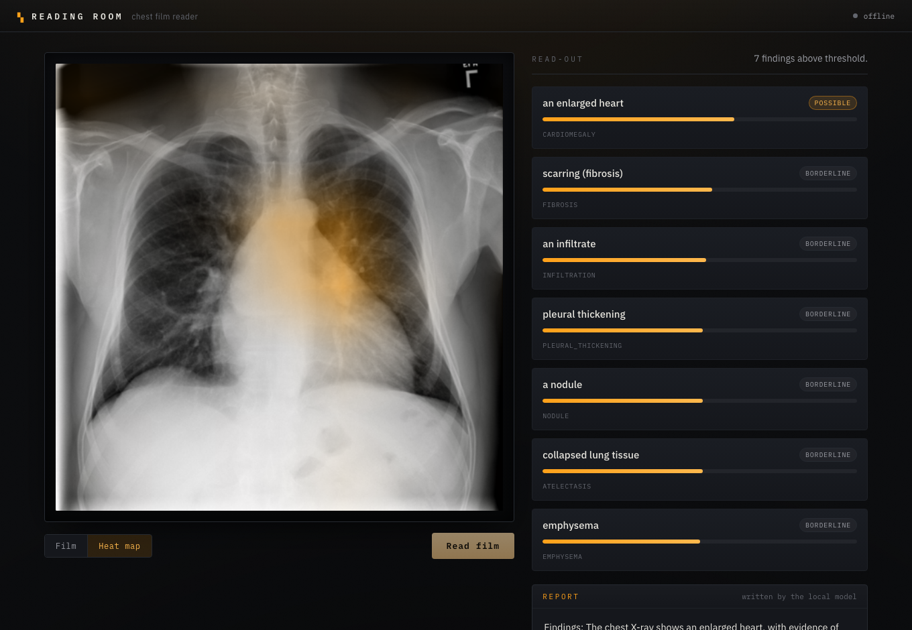

# Chest X-ray Reader

Give it a chest X-ray and a few words about the patient. It reads the film,
points out the likely findings, shows on the image where each one came from, and
writes a short report. If the picture isn't a chest X-ray, it says so instead of
guessing.

Everything runs locally. The models are open. No paid APIs.



## What's under the hood

- **Findings** come from a pretrained chest X-ray model (`torchxrayvision`,
  DenseNet-121 trained on the big public chest datasets). It scores 18 findings.
- **The heat map** is Grad-CAM on the most likely finding, drawn in amber over
  the film so you can see where the model looked.
- **The report** is written by a local language model through
  [Ollama](https://ollama.com) (`llama3` by default). It only ever sees the
  findings the image model detected, so it can't invent something that isn't
  there. If Ollama isn't running, a plain template writes the report instead.
- **The refusal check** is a light guard: if the image is too small, too flat,
  or doesn't light up any chest finding, it won't pretend to read it.

None of this is a medical device. It's a demo. A radiologist reads the real film.

## Layout

```
backend/    FastAPI + the model code
  xray.py       findings, Grad-CAM, the not-a-chest-xray check
  report.py     turns findings into a short report (Ollama, template fallback)
  main.py       the /analyze endpoint
  eval/         AUROC, calibration, and refusal-rate scripts
  tests/        pytest suite
frontend/   Vite + React, the "reading room" UI
```

## Running it

**Backend** (Python 3.10+):

```bash
cd backend
pip install -r requirements.txt
uvicorn main:app --port 8000
```

First run downloads the model weights (about 30 MB). Apple Silicon uses the MPS
GPU automatically.

For the model-written report, have Ollama running with a model pulled:

```bash
ollama pull llama3
```

Without it, the app still works and falls back to the template report.

**Frontend**:

```bash
cd frontend
npm install
npm run dev        # http://localhost:5173
```

Open the page, drop in a chest X-ray, and hit **Read film**. Add `?demo` to the
URL to see a pre-loaded example without uploading anything.

## Tests

```bash
cd backend
pytest -q
```

Covers the reading pipeline, the refusal check, the report writer and its
fallback, and the HTTP endpoint.

## How well does it read?

The model is `torchxrayvision`'s DenseNet, which reports roughly 0.7 to 0.8
AUROC across the common findings on the public test sets. To check it yourself on
labeled films:

```bash
# score a labeled set: per-finding AUROC + calibration
python eval/evaluate.py --labels eval/labels.csv --images-root .

# refusal rate on things that are NOT chest X-rays
python eval/evaluate.py --ood-dir eval/not_xrays
```

`labels.csv` is a plain `path,Finding1,Finding2,...` file of 0/1 labels, so you
can point it at the NIH ChestX-ray14 test split once you've downloaded it.

## Data

- [NIH ChestX-ray14](https://nihcc.app.box.com/v/ChestXray-NIHCC) — open, the
  labels the model was trained on.
- [Open-i / IU Chest X-ray](https://openi.nlm.nih.gov/) — open, films with real
  reports.
- MIMIC-CXR is larger and has full reports, but needs credentialing, so it's a
  later add-on.

The sample film in `backend/tests/fixtures` is one NIH image, used for tests.
